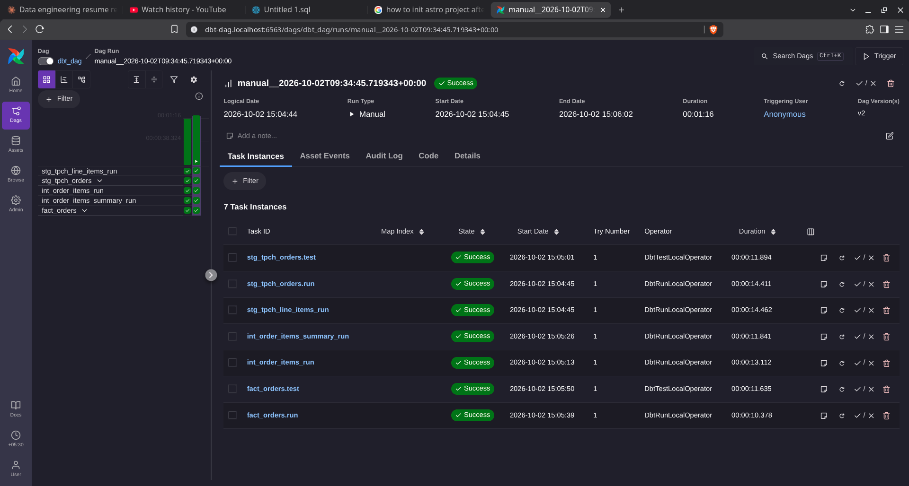

# dbt-dag

An orchestrated ELT project that runs a dbt project on Snowflake from Apache Airflow. The dbt models are rendered as individual Airflow tasks by Astronomer Cosmos, so every model and every dbt test shows up as its own task with its own logs, retries and dependencies.

The project is built on the Astronomer Astro CLI and uses the TPC-H sample data that ships with every Snowflake account, so it runs end to end without loading any external data.

## Table of contents

- [Architecture](#architecture)
- [Tech stack](#tech-stack)
- [Repository layout](#repository-layout)
- [Data model](#data-model)
- [Airflow DAG](#airflow-dag)
- [Prerequisites](#prerequisites)
- [Snowflake setup](#snowflake-setup)
- [Configuration](#configuration)
- [Running locally](#running-locally)
- [Running dbt without Airflow](#running-dbt-without-airflow)
- [Testing](#testing)
- [Example run](#example-run)
- [Security notes](#security-notes)

## Architecture

```
Snowflake sample data (snowflake_sample_data.tpch_sf1)
        |
        v
  dbt staging models (views)
        |
        v
  dbt intermediate and mart models (tables)
        |
        v
  dbt tests (source, generic and singular)

Orchestration: Airflow (Astro Runtime) + Astronomer Cosmos
Each dbt model and test is rendered as an Airflow task
```

Cosmos parses the dbt project at DAG parse time and builds the Airflow task graph from the dbt dependency graph. Credentials are never written into dbt files or into this repository: Cosmos builds the dbt profile at run time from an Airflow connection named `snowflake_conn`, which you create in the Airflow UI (see [Configuration](#configuration)).

## Tech stack

| Component | Purpose |
| --- | --- |
| Snowflake | Data warehouse and transformation engine |
| dbt (dbt-snowflake) | SQL transformations, tests and lineage |
| dbt_utils 1.4.1 | Surrogate key generation |
| Apache Airflow (Astro Runtime 3.3) | Workflow orchestration |
| astronomer-cosmos | Renders the dbt project as native Airflow tasks |
| apache-airflow-providers-snowflake | Snowflake connection support in Airflow |
| Docker and Astro CLI | Local development environment |

## Repository layout

```
dbt-dag/
  dags/
    dbt_dag.py                 Cosmos DAG that runs the dbt project
    exampledag.py              Default Astro example DAG
    dbt/
      data_pipeline/           The dbt project
        dbt_project.yml
        packages.yml
        models/
          staging/             Source definitions and staging models
          marts/               Intermediate models, fact table, generic tests
        macros/                Custom macros (pricing.sql)
        tests/                 Singular data tests
        seeds/  snapshots/  analyses/
  tests/dags/                  Airflow DAG integrity tests (pytest)
  docs/                        Documentation assets
  Dockerfile                   Astro Runtime image plus an isolated dbt virtualenv
  requirements.txt             Python dependencies for Airflow
  packages.txt                 OS-level packages
```

## Data model

The dbt project is named `data_pipeline`. It reads from the Snowflake sample database `snowflake_sample_data`, schema `tpch_sf1`.

| Layer | Model | Materialization | Description |
| --- | --- | --- | --- |
| Staging | `stg_tpch_orders` | view | Renames and selects the key columns from `orders` |
| Staging | `stg_tpch_line_items` | view | Selects line item columns from `lineitem` and builds a surrogate `order_item_key` |
| Marts | `int_order_items` | table | Joins orders to line items and computes the item discount amount |
| Marts | `int_order_items_summary` | table | Aggregates extended price and discount amount per order |
| Marts | `fact_orders` | table | Orders enriched with total extended price and total discount amount |

Lineage:

```
tpch.orders ----> stg_tpch_orders ----------------------+
                        |                               |
                        +--> int_order_items --> int_order_items_summary --> fact_orders
                        |
tpch.lineitem --> stg_tpch_line_items
```

Staging models are materialized as views and mart models as tables, and both run on the `dbt_wh` warehouse (set in `dbt_project.yml`).

### Macro

`discounted_amount(extended_price, discount_percentage, scale=2)` in `macros/pricing.sql` returns the discount as a negative decimal (`decimal(16, scale)`), so that it can be summed directly against revenue figures.

### Tests

- Source tests on `tpch.orders` (`o_orderkey`: not null, unique) and `tpch.lineitem` (`l_orderkey`: not null, unique, relationship to orders).
- Generic tests on `fact_orders`: `order_key` is not null, unique and exists in `stg_tpch_orders` (severity `warn`); `status_code` is one of `F`, `O`, `P`.
- Singular tests in `dags/dbt/data_pipeline/tests/`:
  - `fact_orders_discount`: fails if any order has a positive discount amount.
  - `fact_orders_valid_date`: fails if any order date is in the future or before 1990-01-01.

## Airflow DAG

`dags/dbt_dag.py` defines a single Cosmos `DbtDag`:

| Setting | Value |
| --- | --- |
| DAG id | `dbt_dag` |
| Schedule | `@daily` |
| Catch up | disabled |
| Airflow connection id | `snowflake_conn` (referenced in `dbt_dag.py`, created in the Airflow UI) |
| Snowflake database and schema | `dbt_db`, `dbt_schema` (passed from `dbt_dag.py`) |
| dbt executable | `$AIRFLOW_HOME/dbt_venv/bin/dbt` |
| dbt dependencies | installed at run time (`install_deps=True`) |

dbt is installed in its own virtual environment (`dbt_venv`) inside the Docker image. This keeps dbt and its dependencies isolated from the Airflow environment and avoids version conflicts.

## Prerequisites

- Docker Desktop (or another Docker engine)
- [Astro CLI](https://www.astronomer.io/docs/astro/cli/install-cli)
- A Snowflake account with access to the `SNOWFLAKE_SAMPLE_DATA` share
- Git

## Snowflake setup

The project expects the following objects to exist. Adjust the names here, in `dbt_project.yml` and in `dbt_dag.py` if you use different ones.

```sql
create warehouse if not exists dbt_wh with warehouse_size = 'xsmall' auto_suspend = 60;
create database  if not exists dbt_db;
create schema    if not exists dbt_db.dbt_schema;

-- Use a dedicated role with the minimum privileges needed
create role if not exists dbt_role;
grant usage on warehouse dbt_wh to role dbt_role;
grant all on database dbt_db to role dbt_role;
grant all on schema dbt_db.dbt_schema to role dbt_role;
grant imported privileges on database snowflake_sample_data to role dbt_role;
```

## Configuration

No credentials are stored in this repository. The DAG reads its Snowflake credentials from an Airflow connection whose id is set in `dags/dbt_dag.py`:

```python
SnowflakeUserPasswordProfileMapping(
    conn_id="snowflake_conn",
    profile_args={"database": "dbt_db", "schema": "dbt_schema"},
)
```

Create this connection in the Airflow UI once Airflow is running: **Admin > Connections > Add Connection**.

| Field | Value |
| --- | --- |
| Connection Id | `snowflake_conn` (must match `conn_id` in `dbt_dag.py`) |
| Connection Type | `Snowflake` |
| Login | Snowflake user name |
| Password | Snowflake password |
| Account | Snowflake account identifier, for example `orgname-accountname` |
| Warehouse | `dbt_wh` |
| Role | Optional, for example `dbt_role` |

Database and schema are passed from `dbt_dag.py` through `profile_args`, so they do not have to be set on the connection. Field labels can differ slightly between Airflow versions.

Cosmos converts this connection into a dbt profile at run time, so no `profiles.yml` is needed inside Airflow.

Notes:

- The connection is stored in Airflow's metadata database, not in the repository. It survives `astro dev stop` and `astro dev restart`, but it is removed by `astro dev kill`, and it has to be created again on every new machine.
- The Astro-generated `airflow_settings.yaml` is an empty template and is not used by this project. It is git-ignored.

## Running locally

```bash
git clone <your-repo-url>
cd dbt-dag
astro dev start
```

The Astro CLI starts the Airflow components in Docker and prints the URL of the Airflow UI when it is ready. Then:

1. Open the Airflow UI and create the `snowflake_conn` connection (see [Configuration](#configuration)).
2. Enable the `dbt_dag` DAG.
3. Trigger a run and watch the dbt models and tests execute as Airflow tasks.

Useful commands:

```bash
astro dev stop      # stop containers, keep local state
astro dev restart   # rebuild and restart after changing the Dockerfile or requirements
astro dev kill      # stop containers and remove local state (including the connection)
```

## Running dbt without Airflow

You can also run the dbt project directly, for example while developing models. Create a `profiles.yml` (in `~/.dbt/` or in the project folder, never committed) with a profile named `data_pipeline`:

```yaml
data_pipeline:
  target: dev
  outputs:
    dev:
      type: snowflake
      account: "{{ env_var('SNOWFLAKE_ACCOUNT') }}"
      user: "{{ env_var('SNOWFLAKE_USER') }}"
      password: "{{ env_var('SNOWFLAKE_PASSWORD') }}"
      role: dbt_role
      database: dbt_db
      warehouse: dbt_wh
      schema: dbt_schema
      threads: 4
```

Set the three `SNOWFLAKE_*` environment variables in your shell, then:

```bash
cd dags/dbt/data_pipeline
dbt deps
dbt build
```

## Testing

- dbt tests run as part of the DAG, and can be run manually with `dbt test`.
- `tests/dags/test_dag_example.py` holds the default Astro DAG integrity tests, run with `astro dev pytest`. They check that DAGs import cleanly, have tags, and set task retries to at least 2. Add tags and default retries to `dbt_dag.py`, or relax these checks, to match your standards.

## Example run

A successful manual run of `dbt_dag` in the Airflow UI. It completed in about 1 minute 16 seconds with 7 task instances, each dbt model and test running as its own task:


